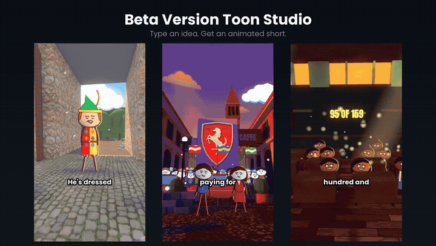

# Beta Version Toon Studio

Turn an idea or your own script into a short vertical (9:16) cartoon video with Claude Code.
Flat drawn characters act in a Blender 3D set, with word-timed captions and camera moves, rendered to `mp4`.

*Click the preview to watch the full showcase (77 s, with sound).*

## What you get
- **A Claude Code skill** (`skill/`). Tell Claude your idea or paste your script, and it writes the shots and runs the kit.
- **A render kit** (`kit/`) with ready-made sets, a character design, word-timed captions, simple sound effects and a music bed.
- **Script help.** From a one-line idea it writes a simple script, or it uses yours word for word.
- **Bring your own voice.** Use a recording or any text-to-speech file, and the kit times the captions to it. With no voice yet, it renders silent on placeholder timings.

## Quick start
1. Install the requirements and the kit: see [SETUP.md](SETUP.md).
2. Open Claude Code in your `Reels` folder.
3. Type `/beta-version-toon-studio` followed by your idea or your script.

## Requirements
- Windows 10/11 with PowerShell
- Blender 5.2
- Python 3.11+
- ffmpeg
- Claude Code
- An NVIDIA GPU is best; a CPU also works, more slowly.

## Licence
MIT: free to use, change and share, including commercially. See [LICENSE.md](LICENSE.md).
If you post something you made with it, a credit ("Made with Beta Version Toon Studio") would be nice, but it isn't required.

## Credits
Showcase music: "Getting it Done" by Kevin MacLeod (incompetech.com), licensed under CC BY 4.0.
