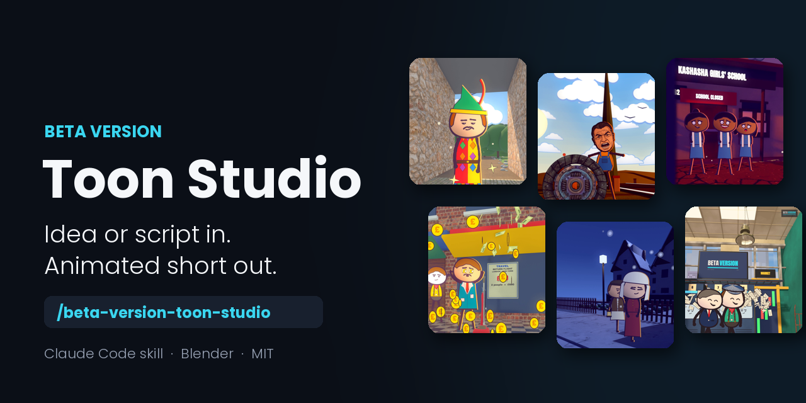

<div align="center">



# Beta Version Toon Studio

**Turn an idea, or your own script, into a vertical animated short with Claude Code.**

[](LICENSE.md)
[](skill/SKILL.md)
[](https://www.blender.org/download/)
[](https://www.instagram.com/beta_versionhq/)
[](https://www.youtube.com/@BetaVersion_HQ)

### **📣 Like it? Follow [@beta_versionhq on Instagram](https://www.instagram.com/beta_versionhq/) and subscribe on [YouTube @BetaVersion_HQ](https://www.youtube.com/@BetaVersion_HQ) for new tools, updates and behind-the-scenes.**

</div>

---

## 🎬 See it in action

https://github.com/user-attachments/assets/59ee3c22-f378-485e-9ebf-55d67782fec2

<div align="center"><sub>Every clip above was made with the toon pipeline this kit comes from.</sub></div>

---

## 📺 Watch the full walkthrough

<div align="center">

<a href="https://youtu.be/ogDCe4KX-Ag" title="I Built a 3D Animation Studio Using Only Claude Code (FREE)">
  
</a>

**▶️ [I Built a 3D Animation Studio Using Only Claude Code (FREE)](https://youtu.be/ogDCe4KX-Ag)**

</div>

---

## ✨ What you get

<table>
<tr>
<td width="50%" valign="top">

### 📝 Script help
Give it one line and it writes a simple script, or paste yours and it uses it word for word.

</td>
<td width="50%" valign="top">

### 🏙️ Ready-made 3D worlds
Streets, offices, a trading floor, a factory, a data centre, a shop, a rooftop, the sea and the desert.

</td>
</tr>
<tr>
<td valign="top">

### 🧑‍🎨 Drawn characters
Flat inked characters walk, talk, point and react, standing inside the 3D set.

</td>
<td valign="top">

### 💬 Word-timed captions
Bring a recording or any text-to-speech voice. Every caption lands on its word.

</td>
</tr>
<tr>
<td valign="top">

### 🎥 Camera and effects
Pushes, tracks, cranes and arcs, plus smoke, sparks, money and confetti.

</td>
<td valign="top">

### 📱 Ready to post
A 9:16 video at 30 fps, with sound effects, a music bed and a short caption.

</td>
</tr>
</table>

---

## 🚀 Quick start

**The easy way:** install [Claude Code](https://claude.com/claude-code), then paste this into it:

```text
Set up github.com/ezpeezee/beta-version-toon-studio on my PC, and run its test.
```

It clones the repo, follows [SETUP.md](SETUP.md), checks your tools (and gives you the install command for anything missing), makes the Python environment, fills in your paths and renders a six-second test clip. With the tools already installed it takes about three minutes. On a fresh PC, expect about 1 GB of downloads first.

**By hand:**

```text
1. Install Blender 5.2, Python 3.11+, ffmpeg and Claude Code
2. Copy skill/ to ~/.claude/skills/beta-version-toon-studio/
3. Copy kit/ to your project and rename it Reels
4. Open Claude Code in Reels and type:

   /beta-version-toon-studio a short video about why bread goes stale
```

Full steps, including the Python environment and paths, are in **[SETUP.md](SETUP.md)**.

## 🛠️ How it works

| Step | What happens |
|---|---|
| **1. Script** | It writes one from your idea, or uses yours. |
| **2. Voice** | Your recording is timed word by word. With no voice yet, it uses placeholder timings. |
| **3. Shots** | Claude writes `sets.py` (the world) and `story.py` (the shots). |
| **4. Look** | Quick stills come first, so problems are fixed before the full render. |
| **5. Render** | Blender renders frames in parallel, then the kit adds captions and joins the shots. |
| **6. Sound** | Sound effects and a music bed are mixed under the voice. |

## 💻 Requirements

| | |
|---|---|
| **OS** | Windows 10/11 with PowerShell |
| **Software** | Blender 5.2, Python 3.11+, ffmpeg, Claude Code |
| **Hardware** | An NVIDIA GPU is best; a CPU also works, more slowly |

---

<div align="center">

## 💙 Support the project

### **If this helped you, [follow @beta_versionhq on Instagram](https://www.instagram.com/beta_versionhq/). It really helps!**

[](https://www.instagram.com/beta_versionhq/)

⭐ Star the repo if you'd like more tools like this.

</div>

---

### License
MIT: free to use, change and share. See [LICENSE.md](LICENSE.md).
If you post something you made with it, a credit ("Made with Beta Version Toon Studio") would be nice, but it isn't required.

### Credits
Showcase music: "Getting it Done" by Kevin MacLeod ([incompetech.com](https://incompetech.com)), licensed under [CC BY 4.0](https://creativecommons.org/licenses/by/4.0/).
